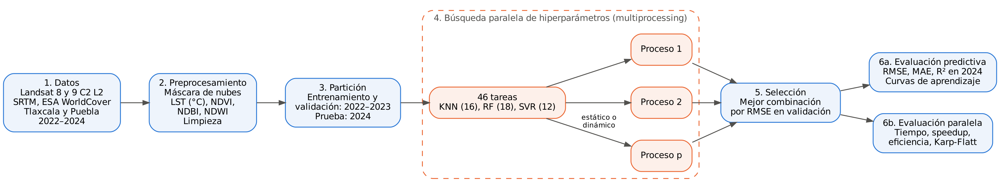

<div align="center">

# Predicción de la temperatura superficial en Tlaxcala y Puebla
### con búsqueda paralela de hiperparámetros

**Proyecto de Cómputo Paralelo · UPIIT – Instituto Politécnico Nacional**


</div>

---

## Resumen

Predecimos la **temperatura superficial terrestre (LST, °C)** de puntos en Tlaxcala y Puebla a partir de su vegetación (NDVI), construcción (NDBI), humedad (NDWI), altitud, pendiente, ubicación, mes y cobertura del suelo, usando imágenes **Landsat 8 y 9 (2022–2024)**.

Comparamos **KNN, Random Forest y SVR**. La búsqueda de hiperparámetros (46 combinaciones) se reparte entre procesos con `multiprocessing`, y medimos **tiempo, speedup, eficiencia y Karp-Flatt**, además de comparar un reparto **estático** contra uno **dinámico** de las tareas.

> El modelo se entrena con 2022–2023 y se evalúa en **2024**, un año que nunca vio.

## Metodología

<div align="center">
  
</div>

| Paso | Qué se hace |
|:---:|---|
| **1. Datos** | Landsat 8 y 9 Collection 2 Level 2, SRTM y ESA WorldCover, descargados con Google Earth Engine |
| **2. Preprocesamiento** | Máscara de nubes, sombras y agua; cálculo de LST, NDVI, NDBI y NDWI; limpieza |
| **3. Partición** | Entrenamiento y validación con 2022–2023 (80 / 20); prueba con 2024 |
| **4. Búsqueda paralela** | 46 combinaciones de hiperparámetros repartidas entre *p* procesos |
| **5. Selección** | Mejor combinación de cada modelo según el RMSE de validación |
| **6. Evaluación** | RMSE, MAE y R² en 2024; curvas de aprendizaje; speedup y eficiencia |

## Estructura del repositorio

```
ProyectoComputoParalelo
├── 01_descarga_datos_GEE.js           # Descarga de datos en Google Earth Engine
├── paralelo.py                        # Limpieza, modelos, búsqueda paralela y métricas
├── 02_prediccion_LST_paralelo.ipynb   # Notebook principal: corre todo el experimento
├── diagrama_metodologia.dot           # Fuente del diagrama de la metodología
├── generar_datos_PRUEBA.py            # Datos inventados, solo para probar el código
├── figuras/                           # Figuras para el documento (PNG a 200 dpi)
└── resultados/                        # Tablas en CSV
```

##  Cómo reproducirlo

**1. Instalar dependencias**

```bash
pip install numpy pandas scikit-learn matplotlib jupyter
```

**2. Descargar los datos**

1. Abrir [code.earthengine.google.com](https://code.earthengine.google.com) con una cuenta registrada en Earth Engine.
2. Pegar `01_descarga_datos_GEE.js`, presionar **Run** y, en la pestaña **Tasks**, ejecutar `LST_Tlaxcala_Puebla`.
3. Descargar `LST_Tlaxcala_Puebla.csv` de Google Drive (carpeta `ProyectoParalelo`) y ponerlo junto al notebook.

**3. Correr el experimento**

```bash
jupyter notebook 02_prediccion_LST_paralelo.ipynb
```

Ejecutar todas las celdas en orden. Las tablas quedan en `resultados/` y las figuras en `figuras/`.

<details>
<summary>⚙️ <b>Parámetros que se pueden cambiar</b></summary>

| Parámetro | Dónde | Por defecto | Para qué |
|---|---|---|---|
| `RUTA_CSV` | Notebook, celda 1 | `LST_Tlaxcala_Puebla.csv` | Archivo de datos |
| `N_MAX_ENTRENAMIENTO` | Notebook, celda 1 | 40,000 | Filas de entrenamiento (para que la búsqueda no tarde horas) |
| `LISTA_PROCESOS` | Notebook, celda 1 | 1, 2, 4, 8 (según los núcleos) | Procesos con los que se mide el tiempo |
| `REJILLA` | `paralelo.py` | 46 combinaciones | Hiperparámetros de KNN, RF y SVR |
| `N_MAX_SVR` | `paralelo.py` | 10,000 | Filas para entrenar SVR, que es el más lento |

</details>

<details>
<summary> <b>Probar sin los datos reales</b></summary>

```bash
python generar_datos_PRUEBA.py
RUTA_CSV=datos_PRUEBA_inventados.csv jupyter notebook 02_prediccion_LST_paralelo.ipynb
```

>  Esos datos son inventados. Sirven solo para comprobar que el código corre; **no se usan en el reporte**.

</details>

## Paralelismo

- Cada combinación de hiperparámetros es una **tarea independiente** (paralelización exploratoria).
- Las tareas se reparten con `multiprocessing.Pool`; los datos se envían una sola vez a cada proceso con un inicializador.
- **Reparto estático:** bloques fijos con el algoritmo de nivelación de cargas (`nivelar`).
- **Reparto dinámico:** cada proceso toma la siguiente tarea al terminar (`imap_unordered`), lo que nivela la carga porque un SVR tarda mucho más que un KNN.
- Cada proceso usa un solo hilo de BLAS, y **no se usa `joblib` ni `n_jobs`** de scikit-learn, como pide la materia.

## Resultados

> Se llenan con las salidas del notebook ejecutado con los datos reales.

| Modelo | RMSE (°C) | MAE (°C) | R² |
|---|:---:|:---:|:---:|
| KNN | — | — | — |
| Random Forest | — | — | — |
| SVR | — | — | — |

| Procesos | Tiempo (s) | Speedup | Eficiencia |
|:---:|:---:|:---:|:---:|
| 1 | — | 1.00 | 1.00 |
| 2 | — | — | — |
| 4 | — | — | — |
| 8 | — | — | — |

## Equipo

| Integrante | GitHub |
|---|---|
| Dulce Teresa Besares Vasquez | [@dulcetbesares-afk](https://github.com/dulcetbesares-afk) |
| Guadalupe Brised Checa Linarte | [@GCK-20](https://github.com/GCK-20) |
| Brandon Romero Palacios | [@Bran379](https://github.com/Bran379) |

<div align="center">

**Unidad Profesional Interdisciplinaria de Ingeniería Campus Tlaxcala (UPIIT) · IPN**

</div>
